# MetaBlend UX review, 20 November 2026

Report only: no code was changed for it. Written by the Fable session so that it can be handed to the Design session as it is. The pictures are in `docs/ux-review/`, named after the entry they belong to.

## What was looked at, and how

- **Build:** `main` a7e92bf plus one commit that changes nothing a visitor sees, built and run on this PC against the dev database. Production was not opened.
- **Views:** the app view (user agent MetaBlendApp: tab bar, hiking section) at 390 px, and the website at 1280 px and at 390 px.
- **Themes and languages:** dark and light. English everywhere; German and Japanese in the app view (every screen measured, the main ones looked at). Also 320 px wide and text at 150 %.
- **Parts that only exist inside the phone app** (notification settings, the rain prompt, Plan a hike, the app icon picker) were made to show with a stand-in for the phone's native layer. No system dialog and no real notification was seen.
- **Ten walks of about 40 screens each,** plus short ones at 320 px and with large text. Every screen was photographed and measured by a script: the size of every control, the name a screen reader gets for it, the contrast of every text, text sizes, cut-off text, colours in use, wording. The script was first run against a page of planted faults and found each of them.
- **Four rules of thumb were measured as well:** the time until the screen answers a tap (Doherty), the number of choices on a first screen (Hick), size and thumb reach of controls (Fitts), and whether the order follows how often things are used. Their numbers are in their own chapter below.

## What a first-time user understands in five seconds

- **App, first start:** a logo, the line "One forecast from up to 20 sources", an offer to use the location, a search field, two buttons without words and a pitch with three feature cards. No temperature, no rain, no mountain. The user understands "a weather app that wants something from me first".
- **App, once a place is chosen:** "Vienna, Austria", 10°, "Partly cloudy", "87% agree" and the sentence "Most of the 19 sources agree on 10-11°." That sentence is the product in one line and it works. Around it sit thirteen controls of which seven have no words.
- **Hiking tab:** a search field and an index of 13 mountain regions. Nothing shows what the tab can tell a hiker.
- **Website, first visit:** an example forecast for Vienna, with one line that says so ("Example: Vienna · search your place below") and the offer to use the location. The product is on the screen at once. On a phone the header rows come first and the temperature starts at y=530 of 844 (W1).
- **Website, with the forecast:** the same forecast, with words on the buttons. Tidy.

So the answer is good and the way to it is cluttered. Most entries below remove something or put a word on it.

## Personas: decided on 20 November

| | Lena, the weekend hiker | Markus, the day decider | Jonas, the model watcher |
| --- | --- | --- | --- |
| Who | 34, Salzburg. 15 to 25 tours a year, mostly day tours up to T4. Decides on Thursday evening where to go on Saturday, checks again Friday night and at five in the morning. Uses a tour app for the track and two weather sites for the summit. | 41, in a city. Bike to work, two children, a dog. Opens a weather app four times a day for ten seconds. Has noticed that his two weather apps often disagree. | 29, flies a paraglider, reads model charts for fun, knows ICON from ECMWF. Has four weather bookmarks already. |
| The one question | "Is my summit on for Saturday, and when do I have to start and be back down?" | "Will it rain where I am in the next hours, and how sure is that?" | "What do the models say right now, and which one has been right here lately?" |
| What MetaBlend must do | Keep her mountains one tap away. Say which day of the week works. Give the window with its reason, wind, freezing level, thunderstorm risk, and a route with times. Tell her the evening before if the window moved. | Open on his place without typing. Put the rain answer first and say in plain words how sure it is. Warn him before rain. | Show every source, the spread, the weights and who was right. |
| Where today's app leaves them | No saved peaks. The peak's Week tab gives no verdict. Plan a hike does not say what it does. The Hiking tab opens on an index. | First start asks him to choose and shows a pitch. Buttons without words. The one sentence he needs is there and good. | Best served today: compare, embed, the sources table, rankings and the heatmap are his tools. He is the smallest group and the least likely to need a new app. |

**Decided by the owner on 20 November: the weekend hiker (Lena) is the main persona. The day decider (Markus) is the second, mainly for the website.** The model watcher keeps his tools, out of the way: behind the Sources panel and under More.

What follows from it, and how the list below is sorted:

- **Hiking comes first in the app.** H2 (save a peak) and P1 (a verdict on the peak's Week tab) are now before submission, next to the small hiking entries N1, O1 and G1. H5 is new: the app should open where the hiker left it.
- **The website serves the day decider.** Its phone header (W1) and the summit pages at phone width (M1), where hikers arrive from a search, move up to before launch.
- **Tools for other people move down:** the rankings layout (L1), the planner's empty page (V1) and the aviation pages' language (A1) are after launch.
- **The load before 3 December:** fifteen entries, four of them medium (F1, S1, H2, P1). That is about ten working days for one session. If time runs short: H2 before P1, and S1 as words on the three buttons instead of removing the row.

## The tester's feedback

> "Focus on UX. You have more than necessary data to make it great. Isolate persona and solve their needs."

That is this report's method: the personas above, and a list that mostly takes things away.

1. **Recents show the same place twice in two spellings.** Confirmed, see R1. Two things to know: today's build names the town the same way on every path, so the accented entry on his phone is most likely left over from before the own place data went live on 30 October. And the cut-off chip on his screenshot could not be reproduced at 320 or 390 px or with large text: the chips wrap and nothing is cut.
2. **Three icon buttons under the search field without text, ⇆ unclear.** Confirmed, see S1. The website at desktop width already writes "Compare" beside the same icon.
3. **The embed button sits as prominently as refresh and share.** Confirmed, see S2. In the app an embed code is of no use at all.

## Four rules of thumb, measured

**Doherty: the screen should answer a tap within 0.4 seconds.** Measured on an emulated mid-range phone (processor four times slower, mobile network with 150 ms each way), as the time until anything visible changes.

| Tap | First visible change | With a poor connection (600 ms each way) |
| --- | --- | --- |
| Today / Tomorrow / Week | 54 to 84 ms | the same |
| Open a panel, star, refresh, compare, day and pace on a route, °C / °F, Light | 7 to 36 ms | the same |
| Tab bar: Forecast, Hiking, More | 44 to 137 ms | the same (these screens are loaded ahead) |
| Search, Enter | 45 ms (the loader), forecast after 0.5 to 3 s | loader the same, forecast later |
| Tap a peak | 223 ms | **721 ms** |
| Tap a route | 205 ms, the route's title after 646 ms | **664 ms**, the title after 2.0 s |

Everything passes on a normal connection. Two taps do not on a poor one, and poor reception is where this app is used: see P5. Buttons do show a pressed state at once.

**Hick: the more choices, the longer the decision.** Controls on the first screen, tab bar not counted: forecast 13, route 15, More 13, Hiking 11, Rankings 11, first start 6, peak 4. The forecast's 13 fall to 11 with S1 and S2 and to about 7 with S6. The route's 15 include four credit links inside the map (O2) and seven day chips (O6).

**Fitts: big targets, close to the thumb.** Size: 79 controls in the app view are under 44 px (X2, table at the end). Reach: on the forecast nine of the thirteen controls sit in the top third of the screen and none in the lower third. The smallest targets of the app, the back links at 20 px, sit in the top left corner, the far corner for a right thumb (X1). The controls used most after the first glance, Today / Tomorrow / Week, scroll away (T4).

**Frequency of use: what is used most comes first.** No numbers exist: the code records no events, so nobody knows which button is used how often (X7). One figure from production, 13 to 19 November, browsers that are no known crawlers: 946 forecast requests against 338 requests for search suggestions, several per typed search. The page is opened to read far more often than to search. Its top third holds the search and eight more controls; the answer starts under them (S6).

## Gold: one job per screen

The owner's rule (20 November): gold has one job per screen, and that job is the main answer: the consensus temperature, the summit window and so on. Selected tabs, toggles and chips do not use gold; they get a neutral highlight. On a screen without an answer the one main button keeps gold, since it is that screen's one job (the owner's answer of 20 November to the question this chapter asked).

Counted on the first screen of each page, leaving out the logo and the sun in weather icons:

| Screen | What gold marks today | What gets gold: the main answer, or the one main button where there is none |
| --- | --- | --- |
| First start | location card, search button, a sparkle, three feature icons | the search button, the one thing to do here; once F1 is done, the example forecast's temperature has it and the button turns neutral |
| Forecast, Today and Tomorrow | search button, selected tab, the chart line, the label "Hour by hour" | the consensus temperature; its line in the chart is the same answer over the day |
| Forecast, Week | selected tab, the "models split" lines | the best day ("Best day of the week") |
| Hiking list | title icon, "My routes", "Import GPX", "Near you", "All peaks" | the next favourable window on a saved peak's row (H2); until then one main button, to be picked from the four that are gold today |
| Peak | selected tab, chart line, two labels, the caution paragraph, a link | the summit window: its headline and its stretch in the chart |
| Route | selected day, selected pace, profile line, a label, "Save route" | the favourable start (start time, or the next favourable day) |
| Summit page (website) | section labels, links | the summit window |
| City page (website) | section labels, links | the consensus temperature |
| Rankings | selected tab, selected region, 19 weight bars | the source trusted most right now |
| Planner | search button, the place, the best months, the bars | the best months |
| More, Aviation, Terms, Support | labels, selected options, links, titles or half of them | no answer here: the one main button where the screen has one ("Send" on Support, "Turn on notifications"), nothing else; a screen without a main button has no gold |

What that means for the rest:

- **Selected things turn neutral:** the range tabs, the day and pace chips on a route, the pickers under More, the region buttons, the saved-city chips, the checkboxes of the notification settings (green today) and the current tab in the tab bar. A raised chip with white text is enough to read as selected.
- **Gold leaves** section labels, links (underlined in the text colour), the caution paragraphs (the warning colour that exists), half-gold titles and the feature icons.
- **Headline cards:** the card that carries the answer is gold when there is one (a window, a start time, a best day) and neutral when there is none. Green stays for status words ("Low", "Good", the agreement figure). T2 follows from this.
- **Main buttons (owner, 20 November):** on a screen without an answer the one main button keeps gold, since it is that screen's one job: "Continue", "Turn on notifications", "Retry", the search button of the first start. Never two gold buttons on one screen. My reading of the rest: on a screen with an answer the answer has the gold, so its buttons are a strong neutral.

Entry X3.

## The short list: before submission on 3 December

Fifteen entries, all small or medium, all in the app. Hiking first:

1. **H2** Save a peak, and keep the peaks looked at.
2. **P1** A verdict on the peak's Week tab.
3. **N1** Say what "Plan a hike" does before the tap.
4. **O1** The route screen's back link names the wrong place.
5. **G1** The bin deletes a route at once.
6. **F1** A forecast after "Continue", not a pitch. **F2** goes with it.
7. **S1** Words on the buttons under the search field, or fewer buttons.
8. **S2** Embed out of the app; refresh and share at a size a thumb can hit.
9. **R1** One place once in Recent.
10. **X1** A way back that is more than a 20 px line of grey text.
11. **Y1** A retry on the error box, and the word "offline" when that is the cause.
12. **E2** Say what notifications bring before asking for them.
13. **X5** Emoji in buttons and sentences. **A2** Em dashes on the aviation pages. Both break house rules and take minutes.

## All problems, by screen

69 entries. Each has an id for reference, the picture it was seen on (folder `docs/ux-review/`), a suggested fix, the effort (small: under half a day, medium: one to two days, large: more) and when it should be done.

| When | Count |
| --- | --- |
| Before submission (3 Dec) | 15 |
| Before launch | 34 |
| After launch | 20 |

### Across all screens

#### X1. The way back is a 20 px line of grey text

- **What is wrong:** "← Back" and "← All peaks" at the top left of Rankings, Heatmap, Planner, Aviation, the airport page, the legal pages, the peak and the route are 51x20 and 77x20 px, in grey.
- **Why it matters:** It is the only way back on screen. Android users and anyone who does not know the swipe have to hit it. Apple asks for 44x44 pt (`accessibility.md`, control sizes); this is under half. It is also the worst case under Fitts's law: the smallest target in the corner farthest from a right thumb. `designing-for-ios.md`: "it tends to be easier and more comfortable for people to reach a control when it's located in the middle or bottom area of the display".
- **Suggested fix:** Give the link a 44 px high hit area (padding, the text can stay small) and let it name where it goes: "← More", "← Großglockner".
- **Effort:** small. **Priority:** Before submission (3 Dec).

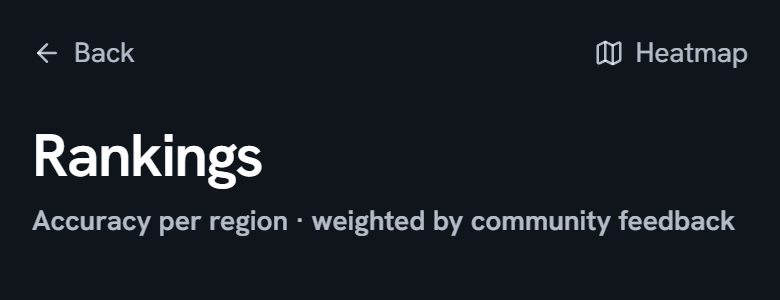

*Rankings in the app: "Back" is 51x20 px*

#### X2. 79 controls in the app view are under 44 px

- **What is wrong:** Measured at 390 px. The worst after the back links: refresh, share, embed 35x27; the bin in My routes 27x27; pace buttons on a route 28 px high; saved-city chips 30; route day chips 32; "Save route" 34; the tabs Today / Tomorrow / Week 36; the pickers under More 36. The full table is at the end of this report.
- **Why it matters:** These are the controls used on every visit, with a thumb, often outdoors and with gloves. The Recent chips were already brought to 44 px with one rule for touch screens; the rest was left.
- **Suggested fix:** One pass with the same rule (`@media (pointer: coarse)`): every button, chip and segmented control at least 44 px high. Small text links (credits, legal) can stay, they are not the main path.
- **Effort:** medium. **Priority:** Before launch.

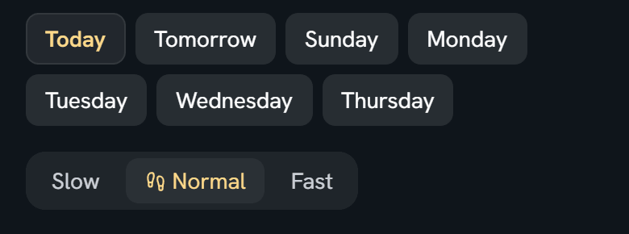

*Route screen: day chips 32 px, pace buttons 28 px*

#### X3. Gold has three to six jobs on every screen; the rule is one, the main answer

- **What is wrong:** Gold is the selected tab, a link, a main button, the chart line, every small section label ("Hour by hour", "Routes", "Settings", "Summit window"), the caution paragraph under the hiking pages, the "models split" warning, the saved-city chips, half of the Terms title and the airport's name. The answer itself is not gold on any screen: the temperature is white, a favourable window green.
- **Why it matters:** The owner's rule: gold marks the main answer of a screen and nothing else. When one colour is label, link, selection and warning at once, it tells the user nothing, and the answer has no colour of its own. `color.md › Best practices`: "Avoid using the same color to mean different things."
- **Suggested fix:** Per screen the one answer from the table in "Gold: one job per screen". Selected tabs, toggles and chips get a neutral highlight. Section labels in grey. Caution text in the warning colour that already exists (`--warn`), with an icon. Links underlined in the text colour.
- **Effort:** medium. **Priority:** Before launch.

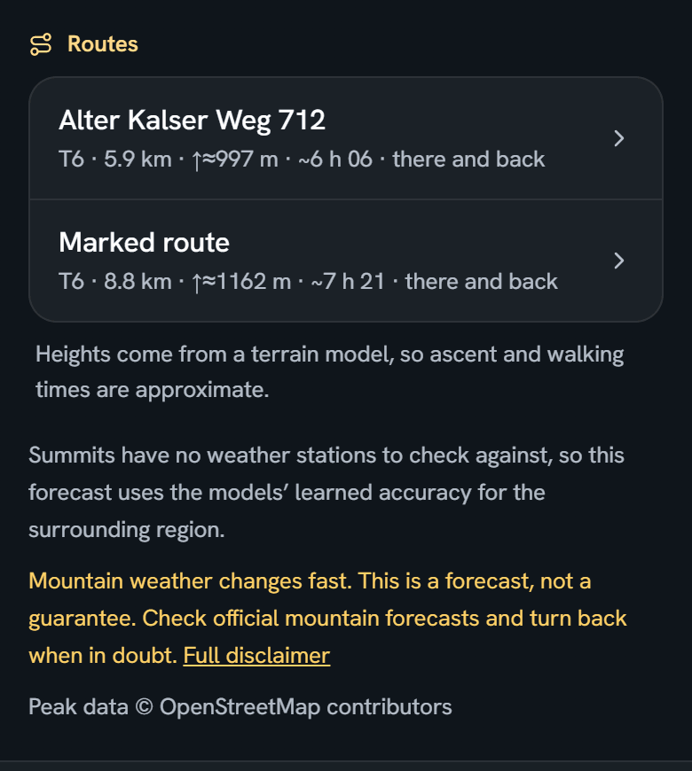

*Peak view: a label, a link and the caution paragraph, all gold*

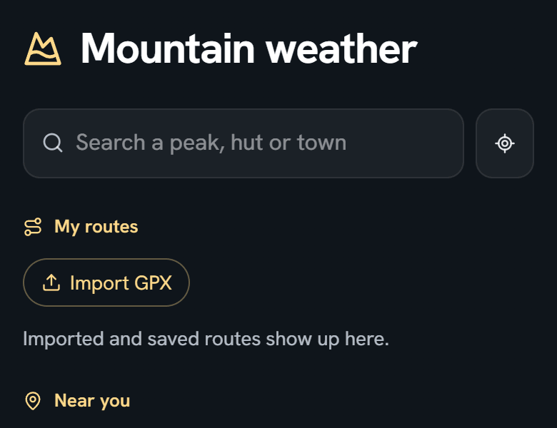

*Hiking: title icon, two labels and a button, all gold*

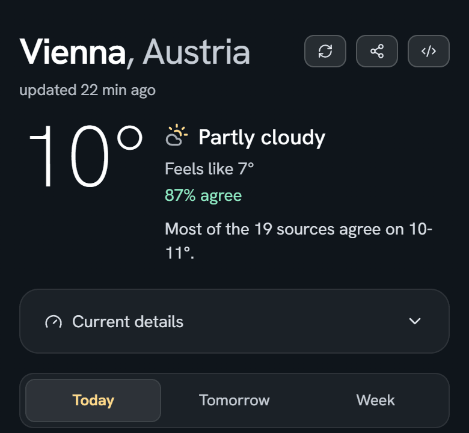

*Forecast: the answer (10°) is white; the selected tab is gold*

#### X4. The caution sentence opens Rankings, Heatmap and Planner

- **What is wrong:** "Forecasts can be wrong. Don't rely on them alone for decisions that life, health or property depend on." stands directly under the title of all three pages, above the content. The Planner shows ten years of climate averages, no forecast.
- **Why it matters:** The first thing read on each tool is a warning about something else. Repeated on every page it also stops being read.
- **Suggested fix:** Keep the words (legal text, the owner and Fable decide on it). Place it under the content on Rankings and Heatmap. Ask Fable whether the Planner needs it at all.
- **Effort:** small. **Priority:** After launch.

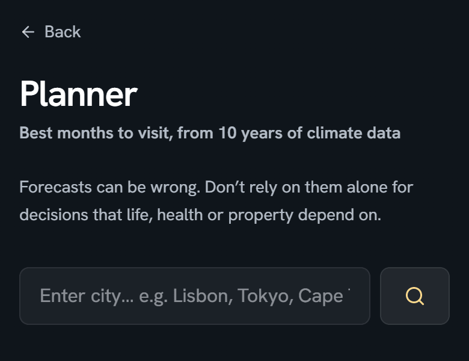

*Planner: title, caution, and an empty page*

#### X5. Emoji and symbol characters in the interface

- **What is wrong:** Rankings region buttons carry flags and globes (phone width). "No planned hikes. Plan one on a peak with 🔔." under More. "⚠" as a text character before "models split by 4° on Wednesday". The code also puts ⛈ and 🌧 into the app's rain warning (HomePage.jsx:1010; not seen on screen).
- **Why it matters:** House rule: no emoji in the interface. They render differently on every phone, a screen reader reads "globe showing Americas", and they sit next to a consistent icon set.
- **Suggested fix:** Icons from the set the app already uses (the bell icon is on the Plan a hike button), no icon at all on the region buttons.
- **Effort:** small. **Priority:** Before submission (3 Dec).

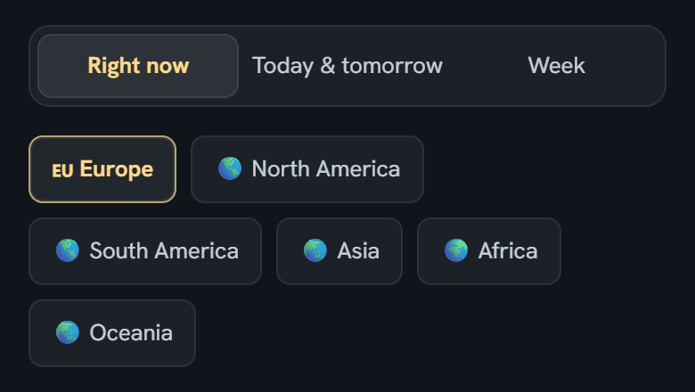

*Rankings, phone: emoji on the region buttons*

*More: an emoji inside a sentence*

#### X6. Ten text sizes

- **What is wrong:** Sizes in use across the app view: 13, 14, 16, 18, 20, 22, 24, 30, 60 and 72 px.
- **Why it matters:** The house rule says about five. 18, 20, 22 and 24 are four sizes for "a bit bigger". Not visible as a fault on any one screen; it is why screens feel slightly different from each other.
- **Suggested fix:** Fold 20 and 22 into 24 or 18. Nothing below 13 px exists anywhere, that rule holds.
- **Effort:** medium. **Priority:** After launch.

#### X7. Nothing records which controls are used

- **What is wrong:** The code sends no events. Page views are counted, but not a tap on Week, Compare, Embed, Share, the star, a panel or Plan a hike.
- **Why it matters:** "What is used most comes first" can only be argued today, not shown. After launch the first weeks of real use are the best data this project will get, and they are lost if nothing counts.
- **Suggested fix:** Eight counted events without any personal data (the analytics already in place can take them): tab switched, panel opened, refresh, share, compare, saved, peak opened, hike planned. Then order the screens by the numbers.
- **Effort:** small. **Priority:** Before launch.

### First start (app)

#### F1. After "Continue" comes a pitch, not weather

- **What is wrong:** The first screen holds: an offer to use the location, a search field, two buttons without words, then a sparkle icon in a rounded square, a centred headline "One forecast, every source.", and three feature cards, each an icon in a rounded square. The five "Try a city" chips are two screens down.
- **Why it matters:** The user installed the app and still sees an advert for it. No number, no rain, no mountain in the first five seconds. It also breaks three of the project's own design rules at once: no sparkle icons, no icon-in-a-rounded-square feature grids, no centred everything. `launching.md`: "People want to start interacting with your app or game right away".
- **Suggested fix:** Show the product: the location card, the search field, the "Try a city" chips directly under it, and below them the example forecast the website already has. Drop the headline and the three cards in the app. For the main persona add one line that leads to the mountains: "Going up a mountain? Summit weather for 195 peaks", which opens the Hiking tab.
- **Effort:** medium. **Priority:** Before submission (3 Dec).
- **Where in the code:** app/HomePage.jsx:987-991 (WelcomeState), the block is app-only.

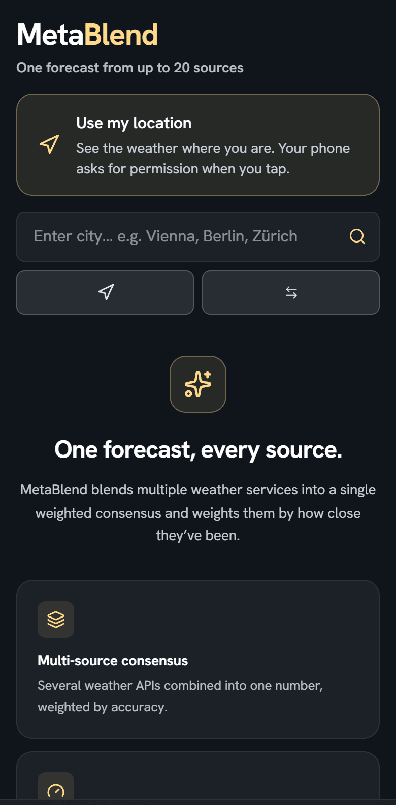

*App, first screen after "Continue"*

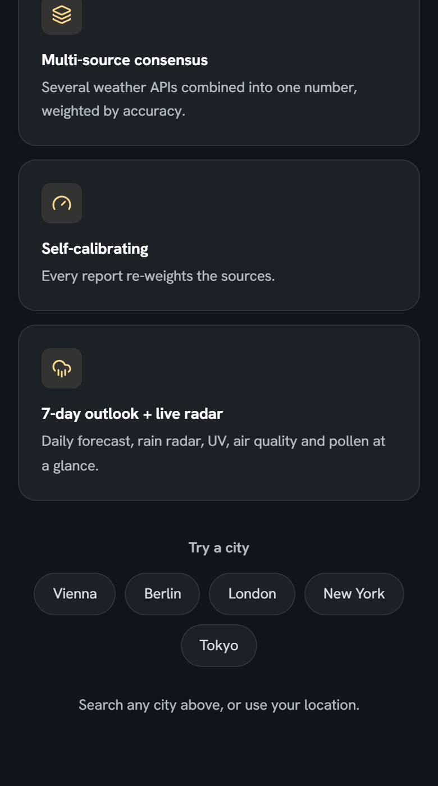

*The useful part, "Try a city", is on the second screen*

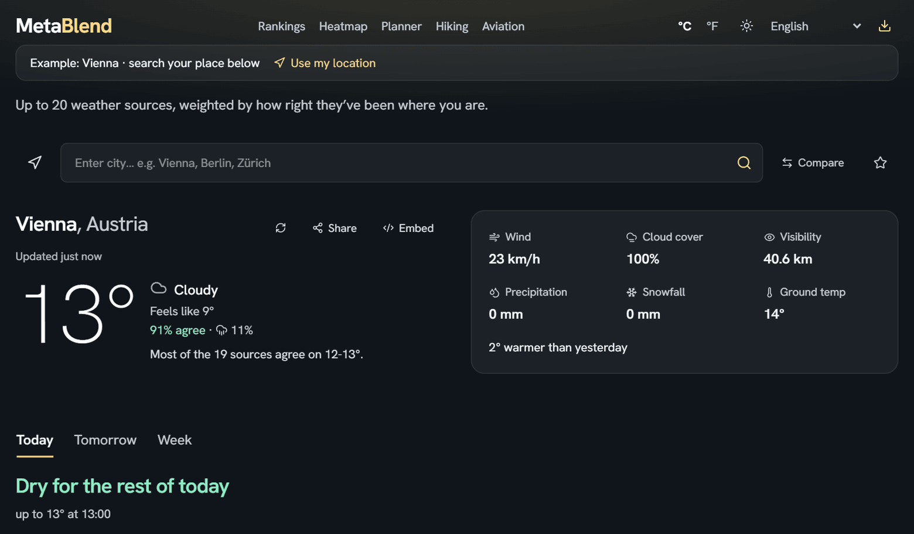

*The website's first visit: an example forecast, marked as one*

#### F2. "Use my location" is offered twice, 60 px apart

- **What is wrong:** The card "Use my location" and, under the search field, a button with only an arrow that does the same.
- **Why it matters:** Two controls for one action make the user wonder what the second one does.
- **Suggested fix:** Hide the arrow button while the card is shown. See S1 for the row as a whole.
- **Effort:** small. **Priority:** Before submission (3 Dec).

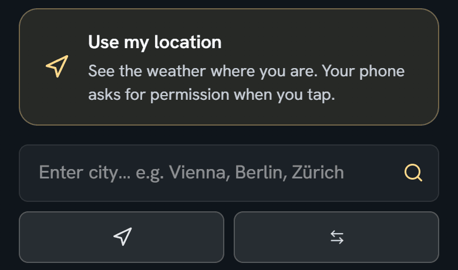

*The card and the arrow button do the same*

### Start page and forecast

#### S1. Three buttons under the search field have no words (tester, point 2)

- **What is wrong:** An arrow, ⇆ and a star, each a 114x44 px button with nothing written on it. ⇆ opens a second search field to compare two cities. All three have names for screen readers ("Use my location", "Compare", "Save this city").
- **Why it matters:** ⇆ is the sign for swap or transfer, not for compare. Three equal blank buttons read as decoration. `buttons.md › Best practices`: "Consider using text when a short label communicates more clearly than an icon." At desktop width the site already writes "Compare" beside the icon; the phone layout drops the word.
- **Suggested fix:** Take the row away. The arrow goes into the left end of the search field (as on the desktop site). The star goes beside the place name it saves. Compare is rare: move it into the share menu or next to the Sources panel, with its word. The forecast then starts 56 px higher.
- **Effort:** medium. **Priority:** Before submission (3 Dec).
- **Where in the code:** app/HomePage.jsx:820-892.

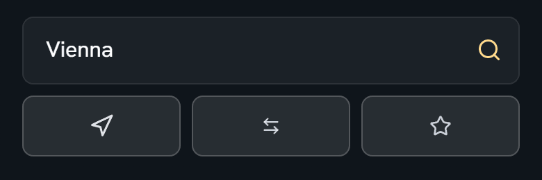

*App: locate, compare, save*

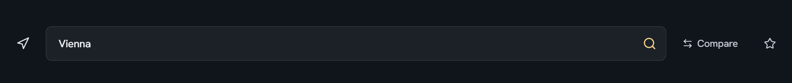

*Website at desktop width: the word "Compare" is there*

#### S2. Embed is as prominent as refresh and share, and all three are 35x27 px (tester, point 3)

- **What is wrong:** Beside the place name: refresh, share and </>. The last opens "Embed this widget. Paste it into any web page." with size and appearance pickers and an iframe code, between the place name and the temperature.
- **Why it matters:** A code snippet for a website is of no use inside a phone app, and on the website it serves perhaps one visitor in a thousand. It holds one of three places at the top of the main screen. The three buttons are also the smallest controls on the page, in its top right corner.
- **Suggested fix:** App: remove Embed. Website: move it into the Share menu or the footer ("Put this forecast on your site"). Refresh and share get 44 px.
- **Effort:** small. **Priority:** Before submission (3 Dec).
- **Where in the code:** app/HomePage.jsx:1024-1064, app/components/EmbedPanel.jsx.

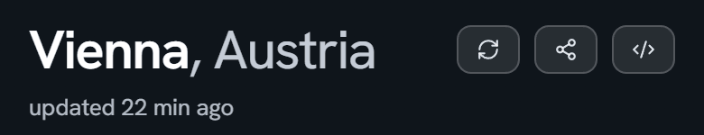

*Refresh, share, embed: 35x27 px each*

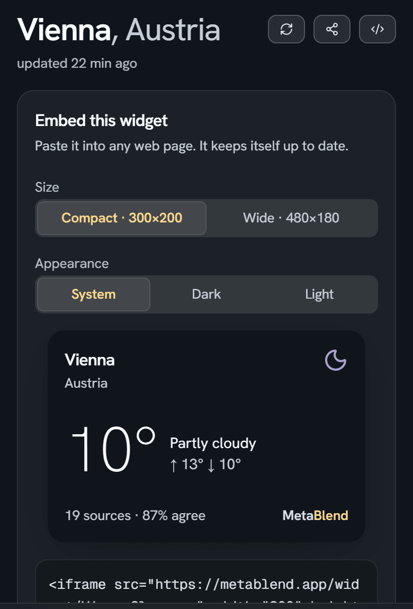

*What </> opens in the app*

#### S3. The place name shares its row with three buttons and wraps

- **What is wrong:** In Japanese the title breaks into "ウィーン," and "オーストリア"; with large text into "Vienna," and "Austria", and "updated 18 min ago" into two lines. The buttons hold the right third of the row.
- **Why it matters:** The place is the title of the screen. It should not give way to an embed button.
- **Suggested fix:** Follows from S1 and S2: with the star beside the name and embed gone, two small buttons are left and the name has the row.
- **Effort:** small. **Priority:** Before launch.

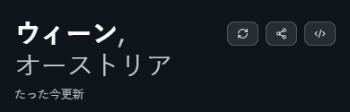

*Japanese: the title wraps*

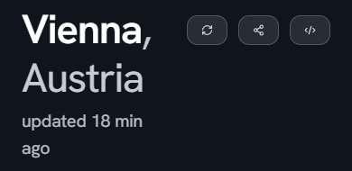

*Text at 150 %*

#### S4. The rain prompt sits two screens down

- **What is wrong:** After three views of a city the app offers "Get a heads-up before rain in Vienna?  Turn on". The card stands between "Rain radar" and "Sources". Its close button is named "×" for screen readers.
- **Why it matters:** This is the one moment the app asks for notifications in context, and for Markus the most useful thing it can offer. Most users never scroll that far. "×" is read out as "times" or not at all.
- **Suggested fix:** Place it directly under the headline card ("Dry for the rest of today"). Name the close button "Not now".
- **Effort:** small. **Priority:** Before launch.
- **Where in the code:** app/HomePage.jsx:1097, app/components/push/PushPrompt.jsx:41.

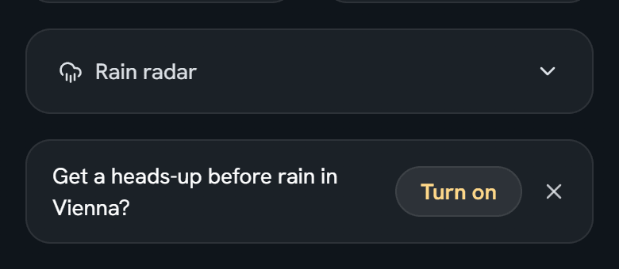

*The prompt, between Rain radar and Sources*

#### S5. Small things on the start page

- **What is wrong:** (a) "Updated just now" with a capital, "updated 2 min ago" without. (b) An empty gap of about 70 px above "What is consensus forecasting?" in the app, where a website-only block is hidden but its space is kept. (c) "Current details" stands between the temperature and the tabs although it belongs to Today.
- **Why it matters:** None is a fault alone. Together they push the forecast down and make the page look unfinished at its end.
- **Suggested fix:** One capitalisation. Remove the gap. Move "Current details" into the Today tab.
- **Effort:** small. **Priority:** After launch.

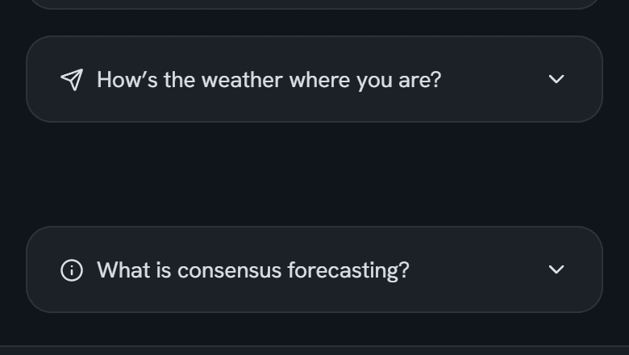

*The gap before the last fold*

#### S6. The order follows how the page grew, not how often things are used

- **What is wrong:** From the top: logo, tagline, search, locate, compare, save, saved places, recent places, place name with refresh, share and embed, then the temperature, "Current details", and only then Today / Tomorrow / Week and the headline. Thirteen controls on the first screen, nine of them in the top third, none in the lower third.
- **Why it matters:** Compare and embed are used almost never and come before the tabs that are used on most visits. Thirteen choices slow the first decision (Hick). The top third is the hardest part of the screen to reach with a thumb (Fitts). Production shows the page is opened to read far more often than to search.
- **Suggested fix:** Top to bottom by use: place and temperature with the sentence about agreement; the headline ("Dry for the rest of today"); Today / Tomorrow / Week; then the chart. Changing the place moves into the title: a tap on "Vienna, Austria" opens search with saved and recent places. Refresh becomes pull to refresh. Share stays, small. The tagline under the logo shows on the first start only.
- **Effort:** medium. **Priority:** Before launch.

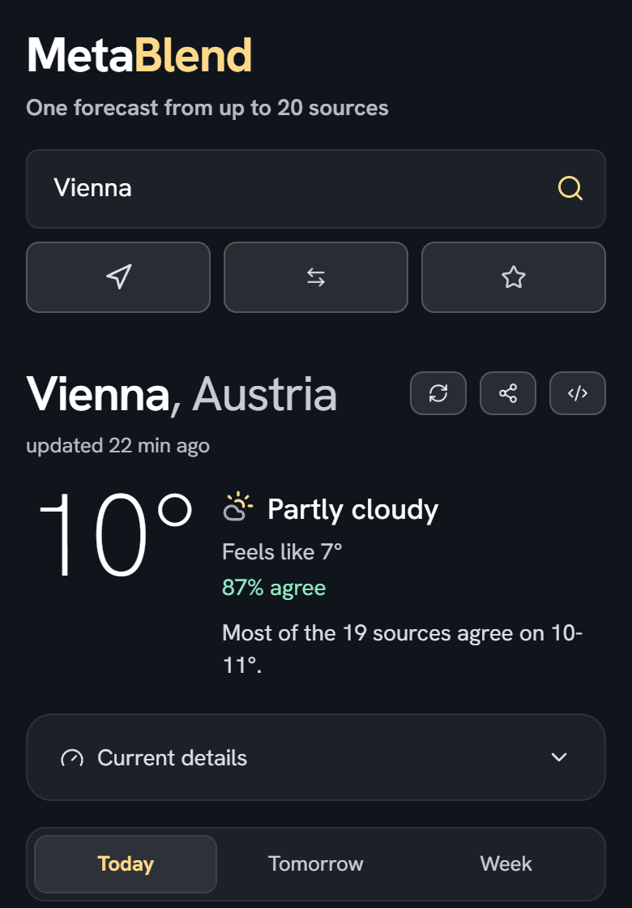

*Thirteen controls before the first line of forecast*

### Search and recent places

#### R1. The same place twice in Recent (tester, point 1)

- **What is wrong:** "Buôn Ma Thuột" and "Buon Ma Thuot" stand side by side as two chips. A new entry is compared with the old ones in lower case only: no accents folded, no check whether it is the same place. Tried today: "Wien" searched in German and "Vienna" searched in English leave both in the list.
- **Why it matters:** It looks like a bug on the first screen, and it uses up two of five places.
- **Suggested fix:** Now: compare with accents removed and merge on reading, so that old entries on testers' phones clean themselves up. Then: store the place (name, position) and compare by position, which also catches Wien and Vienna.
- **Effort:** small. **Priority:** Before submission (3 Dec).
- **Where in the code:** app/HomePage.jsx:83-91 (line 88 is the comparison), line 535 writes the entry.

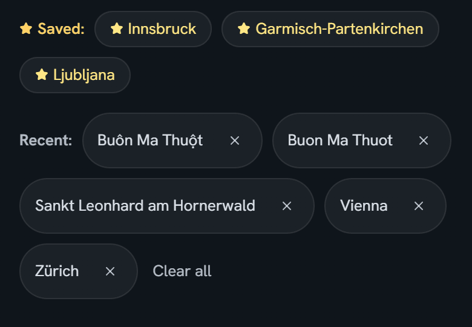

*Two spellings of one town*

#### R2. Saved and recent places push the forecast off the first screen

- **What is wrong:** With three saved and five recent places the chips take 250 px. At 390 px the temperature starts at y=600 of 844, at 320 px at y=700.
- **Why it matters:** The more someone uses the app, the further down its answer moves.
- **Suggested fix:** One row that scrolls sideways (saved first, then recent), or show both only while the search field has the focus, where suggestions already appear. S6 solves it for good.
- **Effort:** medium. **Priority:** Before launch.

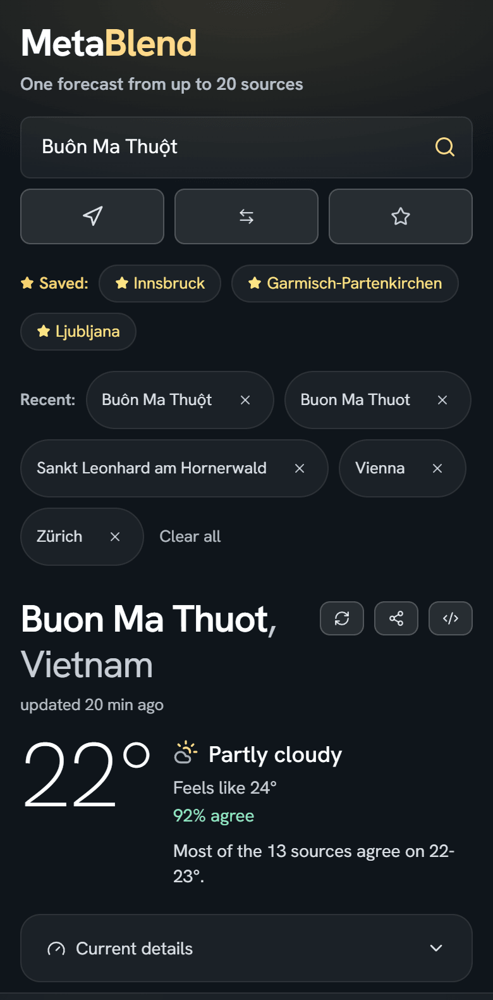

*390 px: the forecast starts at the bottom*

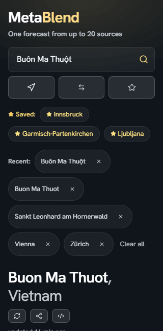

*320 px*

#### R3. One place, two names on one screen

- **What is wrong:** The search field keeps what was typed or tapped ("Buôn Ma Thuột"); the title shows the forecast's name ("Buon Ma Thuot, Vietnam").
- **Why it matters:** The user wonders whether the app found the right place.
- **Suggested fix:** After loading, set the field to the name in the title.
- **Effort:** small. **Priority:** Before launch.

*The field*

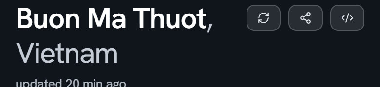

*The title under it*

#### R4. No word when nothing matches

- **What is wrong:** While typing, a name with no match makes the suggestion list vanish without a word. After Enter a red box says the place was not found; the rest of the page is then empty: no "Try a city", no recent places.
- **Why it matters:** `writing.md`: "Provide clear next steps on any blank screens." The sentence in the box is good; the page under it is a dead end.
- **Suggested fix:** A row "No place found" in the suggestion list. Keep the recent places and "Try a city" under the red box.
- **Effort:** small. **Priority:** Before launch.

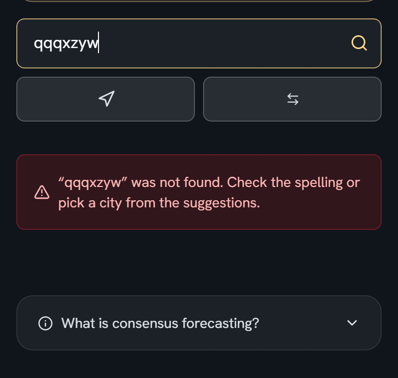

*Not found: a good sentence over an empty page*

#### R5. Saved chips are 30 px high, recent chips 44

- **What is wrong:** Two rows of chips of the same kind, one row a third lower than the other. A saved place has no × either: it can only be removed by opening it and tapping the star.
- **Why it matters:** Inconsistent, and the smaller row is the one the user chose to keep.
- **Suggested fix:** Same height. Long press or an edit mode to remove.
- **Effort:** small. **Priority:** Before launch.

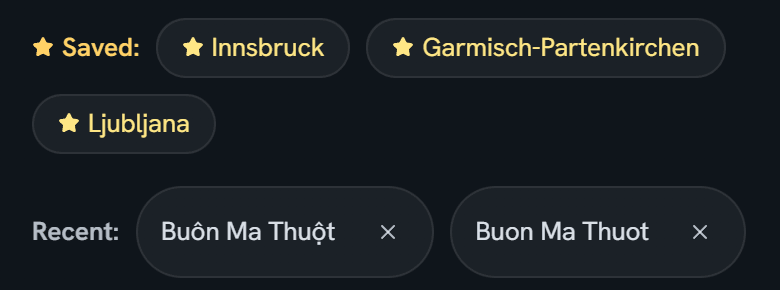

*Saved (30 px) above Recent (44 px)*

### Today, Tomorrow, Week

#### T1. The week list does not explain its dots and does not look tappable

- **What is wrong:** Every row ends in three dots, filled or empty. What they mean stands under the list ("●●● = sources agree · tap a day for its hours"). Nothing on a row shows that it opens.
- **Why it matters:** The dots are MetaBlend's own idea, how much the sources agree. A user who does not scroll to the legend takes them for decoration, and nobody taps a row that looks like text.
- **Suggested fix:** A column heading over the dots ("Agreement") or the legend above the list. A chevron at the end of each row.
- **Effort:** small. **Priority:** Before launch.

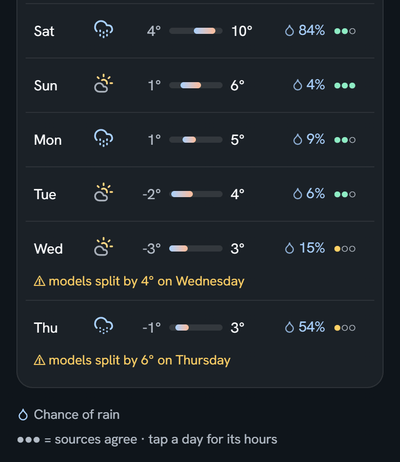

*Week: the legend comes after the last row*

#### T2. The headline card changes colour with the weather

- **What is wrong:** Green for "Dry for the rest of today", blue for "Rain likely 06:00-09:00 tomorrow", red for "No favourable start today" on a route, blue again for "No favourable summit window today".
- **Why it matters:** The house rule knows gold as accent and green for status. Blue is used well for water and cold in every chart; as a card colour it becomes a second accent, and "no window" is blue on the peak and red on the route.
- **Suggested fix:** By the gold rule: the card that carries the answer (a dry day, a window, a start time) is gold, the card without one ("No favourable window", "No favourable start") is neutral, on peak and route alike. Rain keeps its blue in the charts, not as a card colour.
- **Effort:** small. **Priority:** After launch.

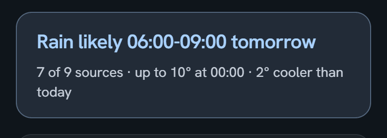

*Tomorrow: blue*

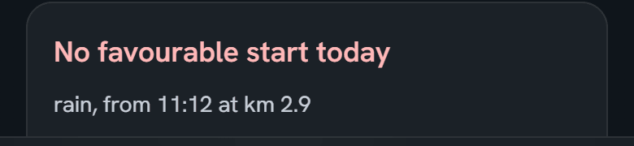

*Route: red for the same kind of message*

#### T3. Blue small print on the week cards looks like links

- **What is wrong:** "this week" and "normal 2" under "vs normal (10 yrs)" and "Rainy days" are set in blue. They are not links. The German label "ggü. Mittel (10 J.)" has two abbreviations in four words.
- **Why it matters:** Blue small print invites a tap that does nothing.
- **Suggested fix:** Grey like other secondary text. German: "Abweichung vom 10-Jahres-Mittel".
- **Effort:** small. **Priority:** After launch.

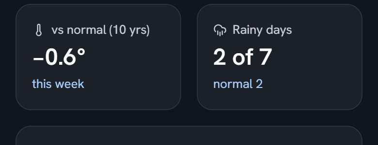

*The two cards under the week list*

#### T4. Today / Tomorrow / Week scroll away and cannot be swiped

- **What is wrong:** The three tabs sit at y=530 on the forecast and leave the screen with the first scroll. To see tomorrow after reading today's hours the user scrolls back up. A sideways swipe does nothing.
- **Why it matters:** The most used control after the first glance should stay within reach. A swipe has no target to miss, which is the best case under Fitts's law.
- **Suggested fix:** Keep the tabs under the top edge while scrolling. Let a sideways swipe on the forecast change the day.
- **Effort:** medium. **Priority:** After launch.

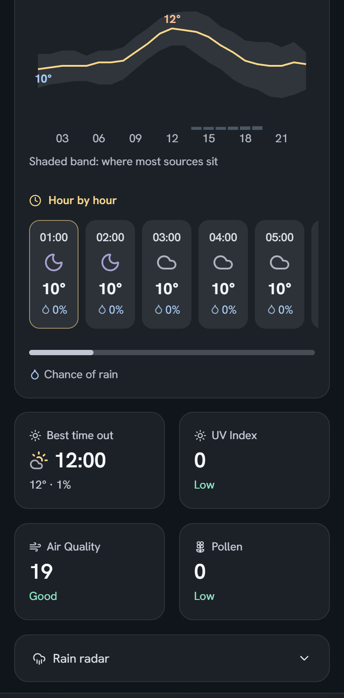

*One scroll down: the tabs are gone*

### Rain radar

#### D1. The map is Leaflet as it comes out of the box

- **What is wrong:** White zoom buttons, a bright blue pin, the "Leaflet" credit with a flag, and the OpenStreetMap credit twice: in the map and in the line under it. The same on the heatmap and on route maps, where the credit box covers a fifth of the map (O2).
- **Why it matters:** Three foreign elements in a screen that is otherwise drawn carefully. The pin is the only bright blue object in the app. The "Leaflet" link is also the app's one real contrast failure (3.2:1).
- **Suggested fix:** Zoom buttons in the theme's colours, a gold dot for the place, the "Leaflet" prefix off (it is optional), one OpenStreetMap credit (that one must stay).
- **Effort:** small. **Priority:** Before launch.

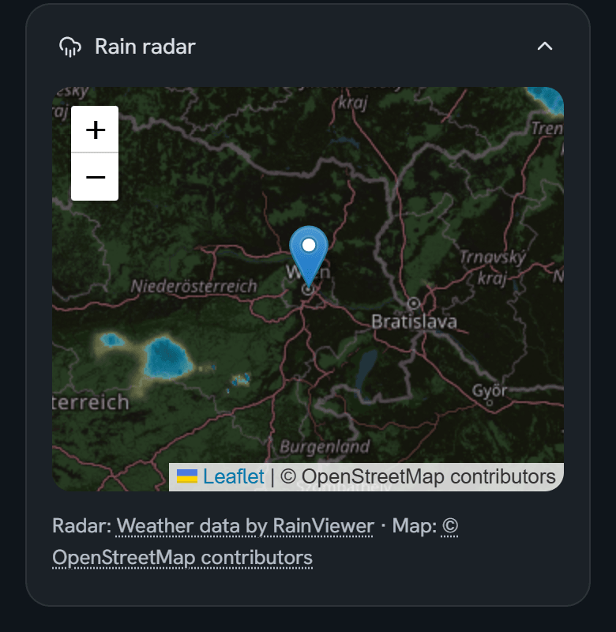

*Rain radar in the app*

#### D2. The radar picture has no time and no legend

- **What is wrong:** The map shows coloured patches. Nothing on the screen says from when the picture is or what the colours stand for, and no control to play it was visible.
- **Why it matters:** Radar answers "is it coming my way". Without a time it answers nothing; an old picture looks like a current one.
- **Suggested fix:** A time on the map ("Radar 00:10") and a three-step legend (light, moderate, heavy). Playing the last hour is the step after that.
- **Effort:** medium. **Priority:** Before launch.

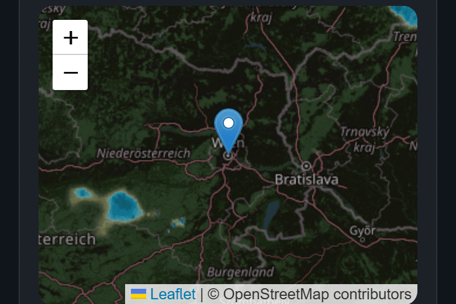

*No time, no legend*

### Sources list

#### Q1. A whole paragraph is one link, and the credit line is one long underline

- **What is wrong:** Under the sources table: "Includes WeatherAPI.com data. General information only, not the sole basis for decisions that life, health or property depend on (see the notice)." is underlined from first word to last. Under it the credit line, every provider underlined.
- **Why it matters:** Hard to read, and a block of underlined text hides the one link that matters to most users ("Rankings").
- **Suggested fix:** Keep every word (they are licence and legal text). Underline only "see the notice". Set the credits as plain small text with the links on the names, not on "Weather data by".
- **Effort:** small. **Priority:** After launch.

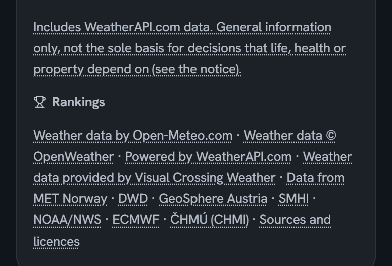

*Under the sources table*

#### Q2. The "Condition" field has no name for screen readers

- **What is wrong:** In "How's the weather where you are?" the select under the label "Condition" is announced as an unnamed pop-up button. The label is not tied to it. It is the only form control of ours without a name.
- **Why it matters:** A VoiceOver or TalkBack user cannot tell what to choose.
- **Suggested fix:** Tie the label to the field (`htmlFor` and `id`).
- **Effort:** small. **Priority:** Before launch.

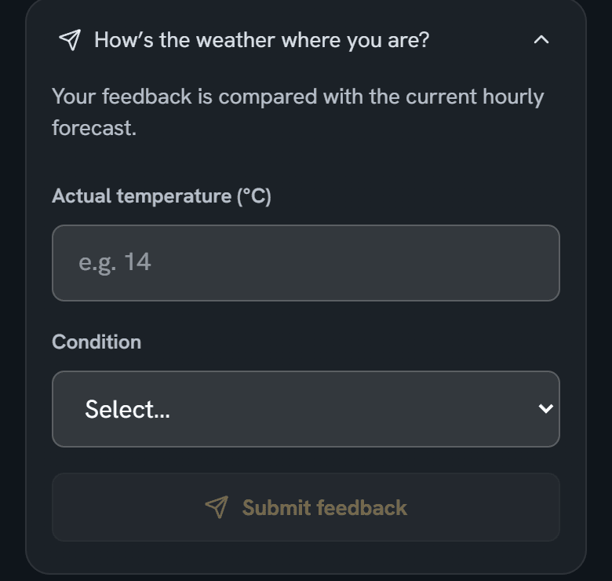

*The feedback form*

### City pages

The list of cities and the page for one city (website pages, also reachable in the app) read well at every width. Their only entries are the small targets: city chips 30 px high and breadcrumb links 20 px, both in the table at the end (X2).

### Hiking: the peak list

#### H1. The Hiking tab opens on an index, without any weather

- **What is wrong:** A first-time user gets a search field, "My routes" with an import button, and "All peaks": 13 region rows with counts. Once a city was looked at, "Near you" lists the nine nearest summits around it by distance alone; for Vienna that is Leopoldsberg, 425 m, and eight more wooded hills. No row on either screen carries a window, a temperature or a wind.
- **Why it matters:** The tab holds the most distinctive thing MetaBlend has and does not show it. The website's own teaser for this section does better: it shows one peak with "Summit window today 09:00-12:33".
- **Suggested fix:** Above the index: the user's saved peaks (H2), each with today's window in one line. For a first-time user three well-known peaks with their window, and the location offer as a card, like "Use my location" on the forecast tab. In "Near you", today's window on each row.
- **Effort:** medium. **Priority:** Before launch.

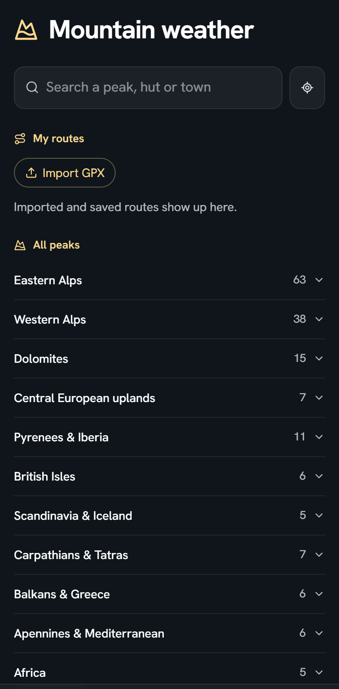

*Hiking tab, first start*

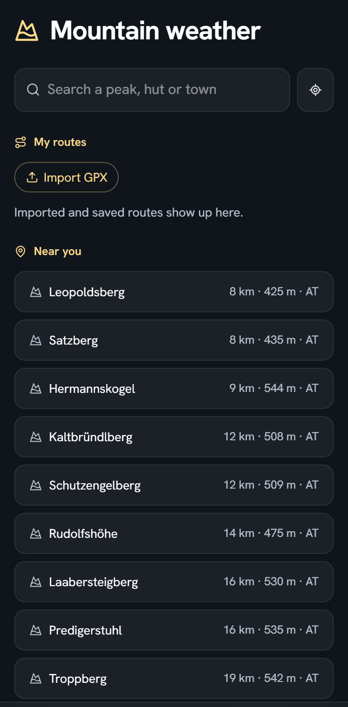

*After Vienna was looked at: the nearest hills, no weather*

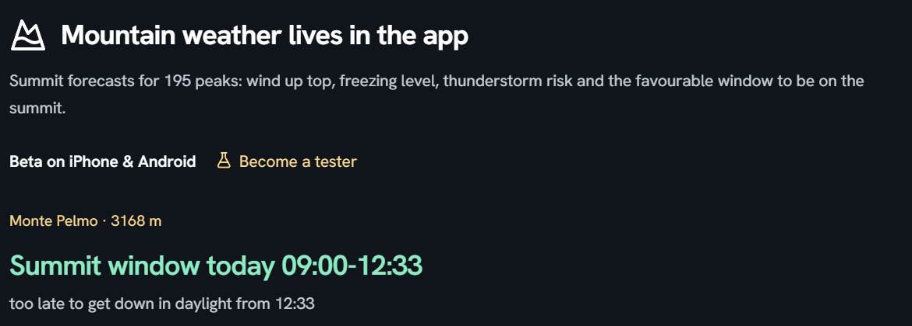

*The website's teaser shows an answer*

#### H2. A peak cannot be saved, and peaks looked at are not remembered

- **What is wrong:** Cities have "Saved" and "Recent". A mountain has neither. Only routes can be saved. To see the Großglockner again the user searches again or opens "Eastern Alps" and scrolls.
- **Why it matters:** Lena checks the same three mountains on Thursday, Friday and Saturday morning. This is the most important missing piece for her.
- **Suggested fix:** A star on the peak view. "My peaks" at the top of the Hiking tab, each row with name, height and the next favourable window. Recently opened peaks under it.
- **Effort:** medium. **Priority:** Before submission (3 Dec).

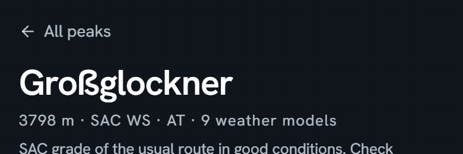

*Peak view: no way to keep it*

#### H3. One section, three names

- **What is wrong:** The tab is "Hiking". The page it opens is titled "Mountain weather". The website's menu says "Hiking", its page "Mountain weather lives in the app", the list page "Mountain weather" again.
- **Why it matters:** `tab-bars.md › Best practices`: a tab label helps "by clearly describing the type of content or functionality the tab contains".
- **Suggested fix:** One name. "Mountains" fits the tab, the page and the website.
- **Effort:** small. **Priority:** Before launch.

*The page title*

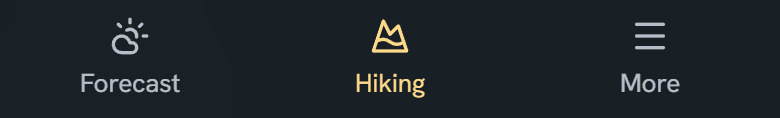

*The tab*

#### H5. The app opens on the city forecast, whatever the user came for last time

- **What is wrong:** The tab bar is Forecast, Hiking, More, and the app always starts on Forecast. A hiker who closed the app on the Großglockner starts the next morning on a city and needs a tap on Hiking and a search to get back (H2).
- **Why it matters:** The main persona opens the app for a mountain. The check at five in the morning should be one glance, not three taps.
- **Suggested fix:** Open the app on the tab used last, and on the Hiking tab show the saved and last peaks first (H1, H2). Whether Hiking should be the first tab is a decision for after launch, with the numbers from X7.
- **Effort:** small. **Priority:** Before launch.

*The tab bar: the hiker's tab is the second*

#### H4. Search finds peaks through names it does not show

- **What is wrong:** Typing "Glock" lists Großglockner, Glockturm and Glockhaus, and also "Bell Stone · Rio de Janeiro · BR" and "Dzwonkówka · Lower Silesia · PL".
- **Why it matters:** Matches through a name in another language look like errors when that name is not shown.
- **Suggested fix:** Show the matching name in brackets, or rank such matches last.
- **Effort:** small. **Priority:** After launch.

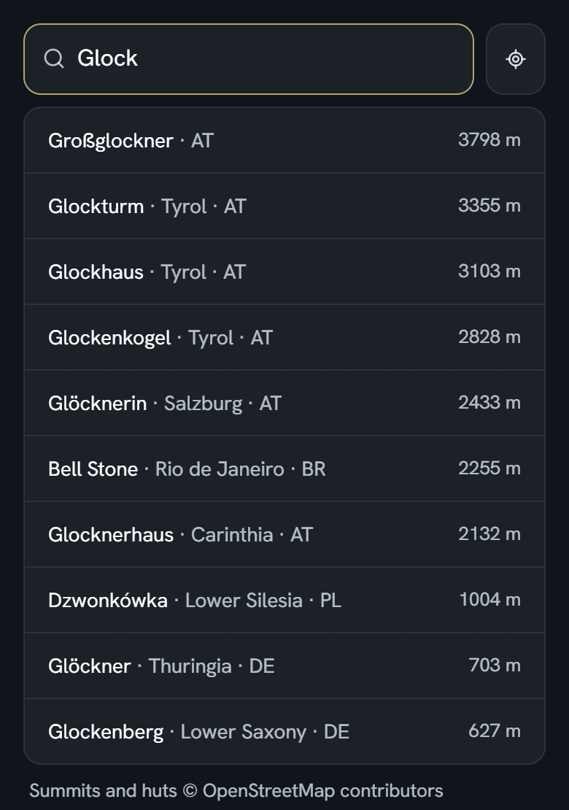

*Results for "Glock"*

### Hiking: the peak page

#### P1. The peak's Week tab gives no verdict

- **What is wrong:** Seven rows with icon, low and high, wind, freezing level and storm bars. No rain, and no word on which day has a favourable summit window. The Today and Tomorrow tabs have a headline; Week has none. The city forecast's Week tab has one ("Best day of the week: today").
- **Why it matters:** "Saturday or Sunday?" is Lena's question, and this is the screen where she asks it.
- **Suggested fix:** A headline over the list ("Best day: Tuesday, window 08:00-13:00" or "No favourable window this week"). On every row the window or the reason it has none.
- **Effort:** medium. **Priority:** Before submission (3 Dec).

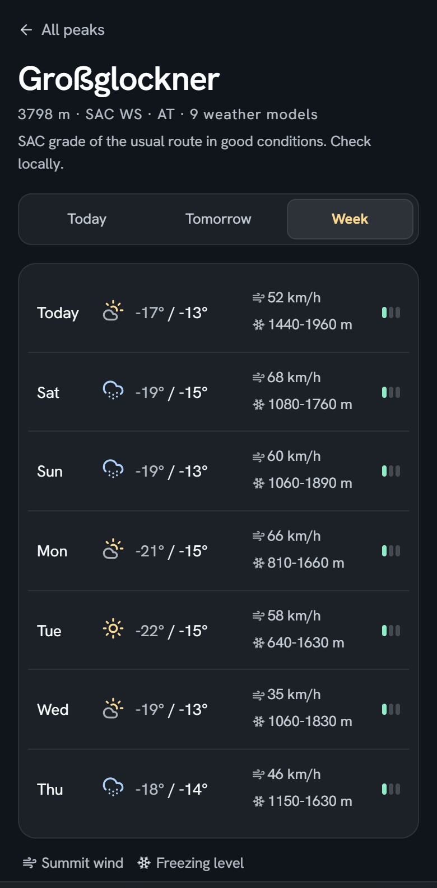

*Peak, Week tab*

#### P2. Route rows do not say where a route starts, and "Marked route" is no name

- **What is wrong:** "Alter Kalser Weg 712 · T6 · 5.9 km · ↑≈997 m · ~6 h 06 · there and back" and "Marked route · T6 · 8.8 km ...". No start point. The peak's header says "SAC WS", both routes say "T6": two grading scales side by side with no word on the difference.
- **Why it matters:** A hiker picks a route by where it starts. 997 m of ascent on a 3798 m peak only makes sense with the hut it starts from.
- **Suggested fix:** Show the start with its height (the route data carries "from" and "to" where OpenStreetMap has them; the start height is known). For a route without a name: "Unnamed marked route" plus its start. One line on the two scales, or show only one.
- **Effort:** medium. **Priority:** Before launch.

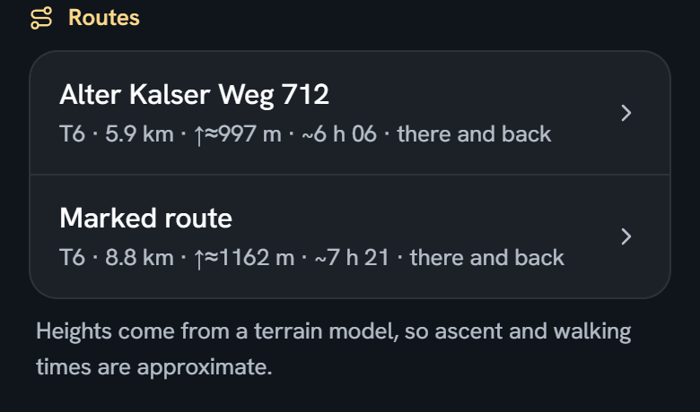

*Routes on the Großglockner*

#### P3. The website's summit page and the app give different reasons for the same day

- **What is wrong:** At the same minute the summit page says "No favourable summit window today, bitter cold from 08:00" and the app's peak view "rain from 08:00". The page is built from three models and stored, the app asks all nine.
- **Why it matters:** By design two forecasts. A user who sees both sees a contradiction.
- **Suggested fix:** On the stored page, say what it is beside the window: "from three models, as of 00:59. Live with all models" as one line.
- **Effort:** small. **Priority:** After launch.

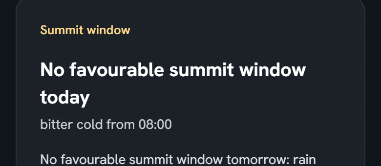

*Summit page (three models)*

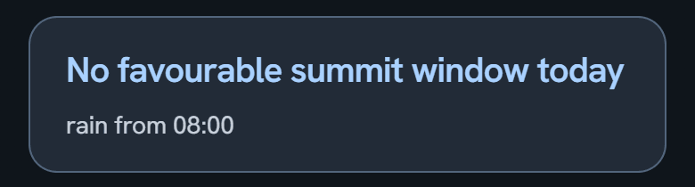

*App (nine models)*

#### P4. Four small paragraphs at the foot of the peak

- **What is wrong:** Heights are approximate. Summits have no stations. The caution. The OpenStreetMap credit. One after the other, the third in gold.
- **Why it matters:** Nobody reads four footnotes in a row, and the one that matters (the caution) is the third.
- **Suggested fix:** The caution first and alone. The other three in one fold, "About this forecast".
- **Effort:** small. **Priority:** After launch.

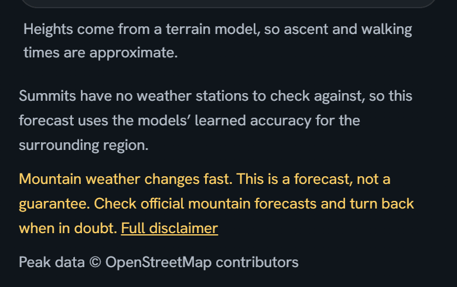

*The foot of the peak view*

#### P5. With poor reception a tap on a peak or a route changes nothing for 0.7 seconds

- **What is wrong:** Both taps wait for an answer from the server before the screen changes. Emulated phone on a normal mobile connection: 223 and 205 ms. On a poor one (600 ms each way): 721 and 664 ms, and the route's title only after 2.0 s. Every other tap in the app answers within 140 ms, whatever the connection.
- **Why it matters:** Over 0.4 s a tap feels ignored (Doherty), and the user taps again. Poor reception at a trailhead or in a hut is where this app is opened.
- **Suggested fix:** Change the screen at once with what the list already knows: the peak's name and height, or the route's name and length, with the loader under it. The tab bar screens already work this way, they are loaded ahead.
- **Effort:** medium. **Priority:** Before launch.

### Hiking: routes

#### O1. The route screen's back link says "All peaks"

- **What is wrong:** On a route opened from the Großglockner the link at the top reads "← All peaks". It leads back to the Großglockner. On an imported route it reads the same and leads to the Hiking tab.
- **Why it matters:** The label promises to throw away where the user is. Some will not tap it and use the tab bar instead, which does lose the peak.
- **Suggested fix:** Name the target: "← Großglockner", "← Hiking". The handler already knows it.
- **Effort:** small. **Priority:** Before submission (3 Dec).
- **Where in the code:** app/components/hike/RouteView.jsx:72 uses the peak view's key `hikeBack`.

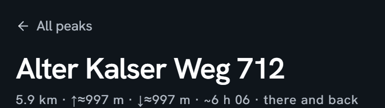

*A route of the Großglockner*

#### O2. The map credit covers a fifth of the map

- **What is wrong:** Three lines of blue links on white inside the map: "Leaflet | Map data: © OpenStreetMap contributors, SRTM | Map style: © OpenTopoMap (CC-BY-SA)". They are four of the fifteen things that can be tapped on the route's first screen.
- **Why it matters:** The map is 270 px high and the route's start lies under the box.
- **Suggested fix:** Move the credit to a line under the map, as the rain radar does. Every name and licence stays.
- **Effort:** small. **Priority:** Before launch.

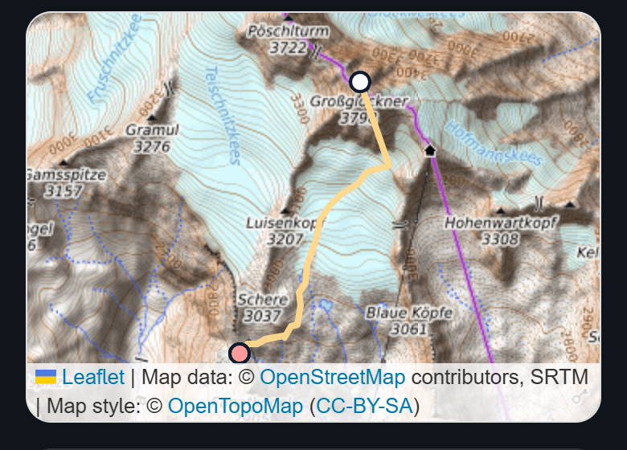

*Route map*

#### O3. Rows marked "rain" show a sun

- **What is wrong:** In "Along the way" the rows from the highest point on are tinted and carry the word "rain". Their icon is sun behind cloud and the chance of rain is 30 %. In the light theme the tint is pink.
- **Why it matters:** The flag, the icon and the number tell three stories. The pink reads as danger.
- **Suggested fix:** Say why the row is flagged ("rain possible, 30 %") and use the rain icon when it is. A calmer tint in light.
- **Effort:** small. **Priority:** Before launch.

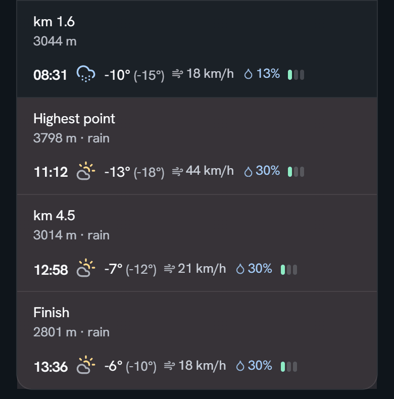

*Dark*

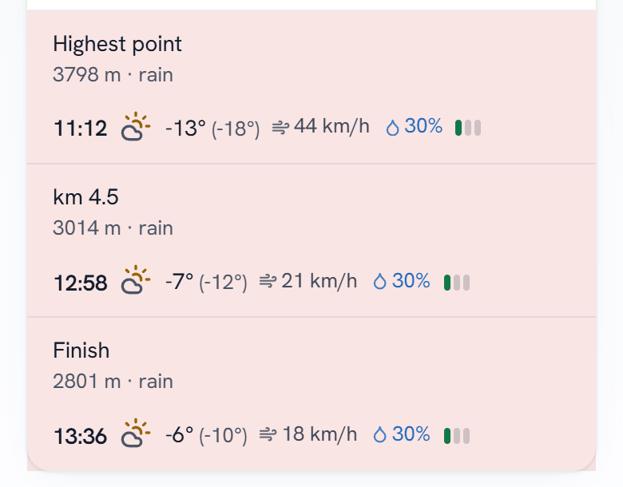

*Light*

#### O4. Save and Plan come after the whole table

- **What is wrong:** "Save route" and "Plan a hike" are the last two things on the screen, under the map, the profile, the day chips, the headline and the table.
- **Why it matters:** The two actions that make a route the user's own are found only by scrolling to the end.
- **Suggested fix:** Beside the title, as a bookmark and a bell with their words.
- **Effort:** small. **Priority:** Before launch.

*The end of the route screen*

#### O5. "Plan a hike" asks for the day again

- **What is wrong:** At the top of the route the user picks a day and a start time. At the bottom "Plan a hike" opens "Which day?" with seven chips.
- **Why it matters:** The app asks a question it already has the answer to.
- **Suggested fix:** Plan for the day that is selected: "Remind me for Sunday, start 07:30".
- **Effort:** small. **Priority:** Before launch.

*"Which day?" a second time*

#### O6. Seven day chips in two rows, in two kinds of words

- **What is wrong:** "Today, Tomorrow, Sunday, Monday" and under them "Tuesday, Wednesday, Thursday". The peak uses three tabs (Today, Tomorrow, Week) for the same choice.
- **Why it matters:** Two controls for "which day" within one section, and the chips take 80 px.
- **Suggested fix:** One row that scrolls sideways with short names (Fri 20, Sat 21 ...), used on peak and route alike.
- **Effort:** small. **Priority:** After launch.

*Day chips on a route*

### Hiking: Plan a hike

Seen with the stand-in for the phone's native layer.

#### N1. "Plan a hike" does not say what it does

- **What is wrong:** A button with a bell. A tap opens "Which day?" with seven chips. Only after a day is picked does a line explain: "Planned. The summit window comes the evening before at 18:00, or at 06:00 on the day."
- **Why it matters:** That sentence is the feature, and it is shown after the decision. "Plan" suggests a planner; it is a reminder with a forecast.
- **Suggested fix:** Put the sentence in the panel, above the chips: "Pick a day. You get the summit window the evening before at 18:00." Consider the label "Remind me".
- **Effort:** small. **Priority:** Before submission (3 Dec).

*Before*

*After picking a day*

#### N2. Planned hikes are listed under More, not under Hiking

- **What is wrong:** After planning, the peak shows the one line and nothing else. The list of planned hikes is under More, Notifications, Hike alerts.
- **Why it matters:** The user plans on the Hiking tab and has to know to look two tabs away to see or cancel the plan.
- **Suggested fix:** On the peak: "Planned for Saturday" with a way to cancel. On the Hiking tab: a "Planned" row at the top.
- **Effort:** medium. **Priority:** Before launch.

*Where planned hikes are listed today*

### Hiking: GPX import and My routes

#### G1. The bin deletes a route at once

- **What is wrong:** A tap on the 27x27 px bin removes the route without a question and without a way back.
- **Why it matters:** An imported track is the one thing in the app the user brought. The bin sits beside the row that opens the route.
- **Suggested fix:** A short message with "Undo" after removing. The bin at 44 px.
- **Effort:** small. **Priority:** Before submission (3 Dec).
- **Where in the code:** app/components/hike/MyRoutes.jsx:38.

*My routes with one imported route*

#### G2. A row in My routes is only a name

- **What is wrong:** No length, no ascent, no date, no next favourable day. The route screen has all of it.
- **Why it matters:** With five routes the list tells nothing apart from names the user may not remember.
- **Suggested fix:** Second line: "2.1 km · ↑1218 m · next favourable day Sunday".
- **Effort:** medium. **Priority:** Before launch.

*One row*

#### G3. The import error is gold, other errors are red

- **What is wrong:** A file that is no GPX gives "This file has no route we can read" in gold under the button.
- **Why it matters:** Gold is the colour of the button above it. See X3.
- **Suggested fix:** The error colour, and one more sentence: "Choose a .gpx file with a track."
- **Effort:** small. **Priority:** After launch.

*After choosing a file that is no GPX*

### Summit pages (website pages, also shown in the app)

#### M1. On a phone the 7-day forecast repeats five labels seven times

- **What is wrong:** Each day is a block with "Low / High, Summit wind, Rain, Freezing level, Storm risk" written out again. At desktop width it is a table.
- **Why it matters:** Thirty-five labels for thirty-five numbers. The week takes four screens.
- **Suggested fix:** The compact rows of the app's Week tab, with one legend.
- **Effort:** medium. **Priority:** Before launch.

*Summit page at phone width*

#### M2. A page built during an outage looks like any other

- **What is wrong:** When the forecast source does not answer, the page is built from the last good forecast. It then shows only its usual "As of" line with an older time.
- **Why it matters:** The start page has a clear banner for the same situation ("Showing last known forecast"). Here the reader has to notice a time.
- **Suggested fix:** A line in the same words as the start page's banner. (A change that rebuilds such a page after 30 minutes instead of six hours is ready on a branch.)
- **Effort:** small. **Priority:** Before launch.

*A page built from the last good forecast: only the time tells*

### More: settings, notifications, language

#### E1. "Explore" is one list of tools, legal pages and feedback

- **What is wrong:** Rankings, Heatmap, Planner, Aviation, Privacy, Terms, Legal notice, Send feedback: eight rows, one list. "Planner" and "Aviation" do not say what they are. With the three pickers above, the first screen of More offers thirteen choices.
- **Why it matters:** Four tools for four different people, three legal pages and a feedback form look alike. A user looking for "is there a travel planner" does not find it under "Planner".
- **Suggested fix:** Three groups. Tools, each with a line: "Rankings: which source is right in your region", "Planner: the best months for a trip", "Aviation: METAR and TAF (in English)". Help: Send feedback, Support. Legal: Privacy, Terms, Legal notice.
- **Effort:** small. **Priority:** Before launch.

*More, Explore*

#### E2. The app asks for notifications without saying what they are

- **What is wrong:** Before turning on: one button "Turn on notifications" and the line "No weather alerts 22:00-07:00 except severe weather, at most 3 a day." The list of what can come (rain soon, thunderstorms, severe weather, heat, a morning briefing, hike alerts) appears only after the user said yes.
- **Why it matters:** The reasons to say yes are hidden behind the yes. The one line shown talks about when alerts do not come.
- **Suggested fix:** Under the button, the list in one sentence: "Rain soon, thunderstorms, severe weather, heat, a morning briefing and your planned hikes. You choose which." Then the quiet-hours line.
- **Effort:** small. **Priority:** Before submission (3 Dec).

*Before turning on*

*After: the list that should have been the offer*

#### E3. Eleven app icons stand above the notification settings

- **What is wrong:** In the app the order is Language, Temperature unit, Appearance, App icon (a grid of eleven, one screen tall), Notifications.
- **Why it matters:** A nice extra pushes the settings people look for off the first two screens. It is set once, if ever; notifications are changed more often.
- **Suggested fix:** Notifications directly under the three pickers. The icon grid last, or folded.
- **Effort:** small. **Priority:** Before launch.

*App icon, before Notifications*

#### E4. The switches are green checkboxes, and "Home city" shows an empty field

- **What is wrong:** Notification choices are checkboxes in bright green with a black tick. "Home city" shows a dash, the link "Change" and under it an empty text field with no hint.
- **Why it matters:** Green is the status colour ("87% agree", "Good"); here it is a control. Everything else that is selected is gold today and becomes neutral with the gold rule; these should follow. The empty field looks broken.
- **Suggested fix:** A neutral highlight for the checkboxes, or switches (by the gold rule, toggles do not use gold; green stays for status). A hint in the field ("Search a city") or show the field only after "Change".
- **Effort:** small. **Priority:** Before launch.

*Notifications on*

#### E5. The app has its own light and dark switch

- **What is wrong:** Appearance: System, Dark, Light.
- **Why it matters:** `dark-mode.md › Best practices`: "Avoid offering an app-specific appearance setting. An app-specific appearance mode option creates more work for people because they have to adjust more than one setting to get the appearance they want." It is a guideline, not a rule, and "System" is the default here.
- **Suggested fix:** No action needed. If the list is ever shortened, this is the first to go.
- **Effort:** small. **Priority:** After launch.

*Appearance*

### Heatmap

The dev database has one point. The entry is about the map.

#### K1. A pale world map on a dark page

- **What is wrong:** The map is light blue and cream, opens on the whole world and uses Leaflet's stock controls. The page around it is dark slate.
- **Why it matters:** The brightest thing on the page is the background of the map, not the data.
- **Suggested fix:** A dark map style, or dim the tiles in dark mode. Open on the region that has data.
- **Effort:** medium. **Priority:** After launch.

*Heatmap in the app*

### Rankings

The dev database has equal weights for every source, so the order seen says little. The entries are about the layout.

#### L1. On a phone each source takes half a screen, with figures for engineers

- **What is wrong:** Rank, name, the internal id under it ("visual-crossing", "owm", "aifs"), an unlabelled "5.5%" with a bar, Score, Reports, Ø Score, "Avg response 566ms" and a sparkline. Nineteen sources make about ten screens. Above them three tabs and six region buttons: eighteen combinations to choose from before the first row.
- **Why it matters:** The page should answer "who is right where I live". Response time in milliseconds and internal ids answer questions nobody outside the project has.
- **Suggested fix:** One row per source: rank, name, weight bar. Details on a tap. No ids, no response time. Label the percentage ("weight in the blend"). Open on the user's own region. On top, the one line the website already has: "Trusted most right now: Canada GEM".
- **Effort:** medium. **Priority:** After launch.

*One source*

*Desktop: a table, still with the ids*

### Travel planner

#### V1. The empty Planner is a title and a field

- **What is wrong:** Title, caution, a search field. Nothing else on the screen. The hint in the field is cut off ("... Tokyo, Cape T"). With a city the result is good: best months, average temperature, rainy days.
- **Why it matters:** The page does not show what it gives until the user has typed a city.
- **Suggested fix:** Three example chips (Lisbon, Tokyo, Cape Town) and one sentence: "Type a city to see its best months, from ten years of weather." A shorter hint.
- **Effort:** small. **Priority:** After launch.

*Empty*

*With a city: this works*

### Aviation

#### A1. In the German app the aviation pages are English from top to bottom

- **What is wrong:** "← Back", "MetaBlend Aviation", the red warning, "Flight categories now", "Europe", "Americas". Only the tab bar is German. The same in Japanese.
- **Why it matters:** Aviation weather itself is English everywhere, so the data can stay. The frame and above all the warning should be read in the user's language.
- **Suggested fix:** Translate the frame: back, headings, the warning (legal text: with Fable). Or say on the More row that this part is in English.
- **Effort:** medium. **Priority:** After launch.

*German app, Aviation: only the tab bar is German*

#### A2. Em dashes, and a lone dash for "no value"

- **What is wrong:** "METAR · TAF · crosswind · density altitude — 12,118 airports", "... public NOAA data — always obtain an official preflight briefing", "(standard lapse rate, dry air) — verify with your POH performance charts". "Weather –" and "Avg response –" where a value is missing.
- **Why it matters:** House rule: no em or en dashes in interface text. The wording test evidently does not reach these pages.
- **Suggested fix:** Full stops and commas. "not reported" for a missing value.
- **Effort:** small. **Priority:** Before submission (3 Dec).

*Aviation: subtitle*

*Airport: warning*

#### A3. Two ways back in one row, and a gold title

- **What is wrong:** In the app view the top row has "← Back" on the left and the breadcrumb "MetaBlend / Aviation / LOWW" on the right. The airport's name is set in gold; every other page title is white.
- **Why it matters:** The breadcrumb is the website's way back and repeats the app's.
- **Suggested fix:** Hide the breadcrumb in the app view. Title in white.
- **Effort:** small. **Priority:** After launch.

*Airport page in the app*

### Terms and privacy

#### Z1. Half of the title is gold

- **What is wrong:** "Terms & Copyright" with "& Copyright" in gold. The texts themselves read well at phone width; nothing is cut off in English, German or Japanese.
- **Why it matters:** An accent on half a headline is decoration, and by the gold rule this screen has no answer to mark. See X3.
- **Suggested fix:** White. No change to the texts.
- **Effort:** small. **Priority:** After launch.

*Terms*

### Error, loading and offline

#### Y1. The error box offers no next step and does not know "offline"

- **What is wrong:** A server error and a missing connection give the same red box: "The forecast could not be loaded." No retry, and the page under it is empty.
- **Why it matters:** `writing.md`: "Write clear error messages ... be clear about what someone can do to fix it." The Sources panel already has an error with a Retry button; the main one has none.
- **Suggested fix:** A "Try again" button in the box. When the phone is offline, say so: "You are offline. No forecast is stored for this place yet."
- **Effort:** small. **Priority:** Before submission (3 Dec).
- **Where in the code:** app/HomePage.jsx:976-980; the retry exists in app/components/outlook/Status.jsx.

*Server error, and the same with no connection*

#### Y2. A screen reader is not told that loading failed

- **What is wrong:** The red box has no alert role. The loading state does announce itself ("Gathering the forecast").
- **Why it matters:** A blind user hears "Gathering the forecast" and then nothing.
- **Suggested fix:** `role="alert"` on the box.
- **Effort:** small. **Priority:** Before launch.

#### Y3. In the light theme the error text is just under the contrast line

- **What is wrong:** Red #d22923 on pink #fde3e3 at 14 px: 4.23:1, the line is 4.5:1. It is the only contrast failure of ours in either theme.
- **Why it matters:** An error is the text that most needs to be readable.
- **Suggested fix:** A darker red, for example #b3201b (5.5:1 on the same pink).
- **Effort:** small. **Priority:** Before launch.

*Light theme*

#### Y4. The app's own offline screen looks like another product

- **What is wrong:** Shown when the app starts without a connection: monospace type, "MetaBlend" all white, "No connection · Keine Verbindung" in two fixed languages, a gold "Retry".
- **Why it matters:** Thirteen languages everywhere else, two here. And the app has the last forecast stored but this screen cannot show it.
- **Suggested fix:** The app's typeface and the two-colour logo. The sentence in the phone's language (thirteen short strings in the file). Later: open the stored forecast with the "You are offline" banner the site already has.
- **Effort:** small. **Priority:** Before launch.
- **Where in the code:** mobile/www/index.html.

*The app without a connection at start*

### Website

#### W1. At phone width the header takes three rows before the page begins

- **What is wrong:** Logo. Then °C, °F, a sun, the language and a download arrow. Then Rankings, Heatmap, Planner, Hiking, Aviation. Then two lines of tagline. The search field starts at y=220, the temperature at y=440. On a first visit the "Example" line comes on top of that: the temperature starts at y=530 and the terms bar covers the last 110 px. The five menu links are 20 px high.
- **Why it matters:** A phone visitor from a search result sees settings and a menu before any weather. On a first visit the example, which is the best thing the page has, gets the narrow strip between the header and the terms bar.
- **Suggested fix:** Units, appearance and language into one menu. The five links into a row that scrolls or the same menu. Links 44 px high.
- **Effort:** medium. **Priority:** Before launch.

*The website on a phone*

*First visit on a phone*

#### W2. A gold arrow in the header with no word

- **What is wrong:** The last item of the header is a download arrow. It installs the site as an app.
- **Why it matters:** A download arrow on a weather site suggests downloading data.
- **Suggested fix:** The words "Get the app", or leave it to the footer and the testers page.
- **Effort:** small. **Priority:** After launch.

*Header, right end*

## Animation ideas, for after launch

None of these is needed before launch. They are listed apart so that they do not mix with the problems above. Rules for all of them: one moment per screen, under one second, only when the content first appears (never on a refresh), never in the way of a tap, and built so that the finished picture is the resting state. The site already has one rule that cuts every animation and transition to nothing when the phone asks for less motion (`globals.css:201`); every idea below must end in its final picture under that rule. `motion.md`: "Make motion optional." and "Add motion purposefully, supporting the experience without overshadowing it."

| Idea | What moves | What it tells | With Reduce Motion |
| --- | --- | --- | --- |
| **Sources flow into the consensus** | When a forecast arrives, the source dots land on the spread line one after another (about 30 ms apart), then MetaBlend's gold tick settles between them and the temperature appears. About 0.8 s, once per place. | What "blended from 19 sources" means, without a word. The loader's "Asking Open-Meteo, Asking WeatherAPI" already sets it up. | Dots, tick and temperature are simply there. |
| **The summit window moment** | On a peak with a favourable window, the window draws across the day's chart from its first hour to its last (0.6 s), then the headline with its two times stands. No window: nothing moves. | The window is a stretch of the day, and it is the answer. Quiet when the answer is no. | The band is there at once. |
| **Agreement dots** | In the week list the three dots of each row fill from left to right, rows 60 ms apart. | That the dots are a measure, not decoration (see T1). | Dots filled as they are. |
| **The route draws itself** | On opening a route its line runs from start to summit on the map and in the profile at the same time (0.8 s). | Which end is the start, and that map and profile are the same line. | The line is there at once. |
| **Day to day** | Today, Tomorrow and Week slide in from the side they lie on (0.15 s), and follow a swipe (T4). | Where the user is in time. | The content swaps without sliding. |
| **Done** | The star fills with a small pop, the bell on "Planned" swings once (0.3 s). A short vibration in the app. | That the tap was taken. | The state changes; the vibration stays. |

Not proposed: numbers that count up (house rule: no countdowns), anything that loops, parallax, and entrance effects on every card.

## Measured, for reference

### Controls under 44 px in the app view (390 px, English)

79 distinct controls, plus 94 summit chips at 34 px on the website's mountain list. Smallest first; "hit" is the area that really takes a tap.

| Control | Hit area | Where |
| --- | --- | --- |
| Email link | 119x17 | More, Legal notice, Support |
| "Legal notice", "Terms" links | 74x18, 38x18 | Terms notice, Support |
| "← Back" | 51x20 | Rankings, Heatmap, Planner, Aviation, airport, legal pages |
| "← All peaks" | 77x20 | Peak, route, imported route |
| "Next favourable day: Sunday, start 07:30" | 251x20 | Route |
| "Back to the forecast" | 124x20 | Page not found |
| "Become a tester", "Rankings" (in Sources), breadcrumb links | 20 high | Summit page, Sources panel, website pages |
| Instagram, TikTok, X | 21 high | More, Support |
| My routes: the row's link | 289x24 | Hiking |
| Refresh, Share, Embed | 35x27 | Start page |
| Bin in My routes | 27x27 | Hiking |
| Slow, Normal, Fast | 28 high | Route |
| Saved-city chips | 30 high | Start page |
| City chips | 30 high | City pages |
| Map zoom + and - | 30x30 | Rain radar, heatmap |
| Embed panel pickers | 32 high | Start page |
| Route day chips | 32 high | Route |
| "Live with all models" | 147x32 | Summit page |
| Own start time | 117x33 | Route |
| "Save route" | 112x34 | Route |
| Today, Tomorrow, Week | 113x36 | Start page, peak |
| °C / °F, System / Dark / Light | 36 high | More |
| "Copy code" | 120x36 | Embed panel |
| "Try a city" chips, region buttons, logo button | 38 high | First start, Rankings, every page |
| Near me (hiking) | 41x49 | Hiking |
| Airport rows | 175x42 | Aviation |
| "Retry" | 92x43 | App offline screen |

On the website at phone width another 20 are added, mainly the five menu links and the footer links at 20 px.

### What held

- **No text under 13 px** on any screen, in any language.
- **Contrast:** every text of ours passes in dark. In light one miss (Y3). The "Leaflet" credit link fails in both (D1).
- **No page wider than the screen, no cut-off text** at 390 and 320 px, in English, German and Japanese.
- **Text at 150 %:** everything wraps, nothing overlaps.
- **Screen-reader names:** every control of ours has one, except the "Condition" field (Q2) and the close button named "×" (S4). The temperature chart is one image with a spoken summary ("Low 10° at 01:00, high 12° at 12:00, rain chance up to 15%"). The tab bar marks the current tab. Not tested with a real screen reader.
- **Wording:** no "safe" and no "sicher" in the interface. The words appear only in the legal texts, where they disclaim.
- **Colours besides gold, green and red:** light blue for rain and cold everywhere (consistent), lilac for the night-sky icons, and the flight-category colours on the aviation pages (the convention pilots know).
- **Response to a tap:** under 0.4 s everywhere on a normal mobile connection (chapter "Four rules of thumb").
- **Reduce Motion:** one rule switches every animation and transition off, and the loader's moving parts too.

## What works and should stay

- **"Most of the 19 sources agree on 10-11°."** One sentence that says what the product is and how sure the forecast is.
- **The loading state:** cloud and sun, "Gathering the forecast", and under it "Asking Open-Meteo", "Asking WeatherAPI" in turn. It says what is happening in the product's own terms.
- **The offline banner** on the start page: "Showing last known forecast. You are offline", with the age under the place name.
- **"Dry for the rest of today, up to 12° at 12:00"** and "Dry for the next 2 hours": the answer before the chart.
- **Route screen:** "No favourable start today. Next favourable day: Sunday, start 07:30." That is exactly what a hiker wants to read.
- **The sentence after planning** ("The summit window comes the evening before at 18:00, or at 06:00 on the day") and the one under the notification switch ("Turning them off deletes your home city, your settings and your planned hikes from our server right away"). Plain and honest.
- **The website's first visit:** an example forecast with one line that says it is an example. It is the model for the app's first start (F1).
- **The Planner's result,** the website's hiking teaser with one live peak, and the Support page.
- **Light and dark** are the same design in two colourings. Nothing breaks in either.

## Not seen

- **Anything the phone itself draws:** the permission dialogs, a real notification, the widgets, the share sheet, the keyboard, swipe-back, the Android back button.
- **A real phone.** Response times come from a desktop browser slowed down to a mid-range phone, not from a device.
- **A real screen reader.** Names and roles were read from the browser's accessibility tree, which is what VoiceOver and TalkBack are given; how it sounds was not heard.
- **Rankings and Heatmap with real data** (the dev database has little).
- **The Impressum** was walked and measured like every page. No picture of it is in this report, because it shows the postal address.
- **Languages other than English, German and Japanese.**
- **The app icon picker's result** (it showed with the stand-in; changing the icon is the phone's job).
